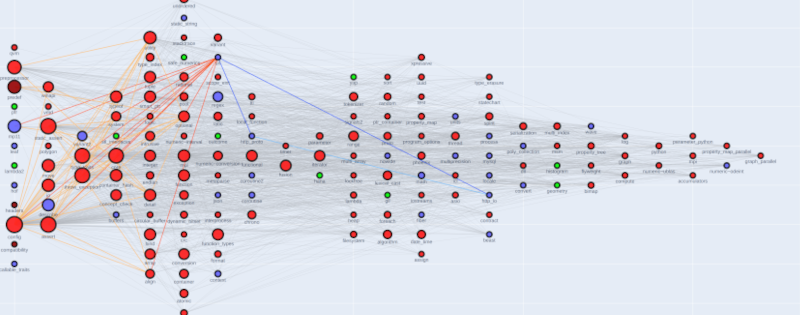

# Boost Dependency Graph



An interactive single page that shows how the Boost libraries depend on each other: https://alandefreitas.github.io/boostdep_graph/

Click a library (or search for it) to see what it needs and what needs it. The legend on the page doubles as the control panel: every color, border, marker and edge style is explained there, and each row has a switch to show or hide it. Test and example dependencies are off by default and can be included with two switches.

## Links and URL hash

The page state lives in the URL hash, so views can be shared:

- `#url`: open focused on the `url` library
- `#url&tests=1&examples=1`: also show test and example dependencies
- `#url&labels=0`: only options that differ from the default are stored (`key=0` or `key=1`)
- `#&cat=IO,Math&std=11,14`: filter by category and C++ standard
- `#url&layout=vertical`: vertical layout (foundations at the bottom); `layout=horizontal` forces the sideways one. Without it the layout is automatic: vertical on portrait screens, horizontal otherwise

Option keys (`=0` or `=1`): `background`, `deps`, `tdeps`, `rdeps`, `trdeps`, `category`, `paths`, `colorStd`, `sizeImportance`, `stdAltMarker`, `buildableMarker`, `toolMarker`, `deprecatedMarker`, `proposedMarker`, `labels` (all on by default), `tests` and `examples` (off by default). `cat=` lists the categories that stay lit, `cat=-` means none, and `cat=` with no name means only libraries without a category. `std=` lists the standards that stay lit (`03` also covers 98).

Old per-library links such as `libs/url.html` redirect to `#url`.

## Generating the data locally

Clone the Boost super-project and build `boostdep`:

```bash
git clone https://github.com/boostorg/boost.git -b develop boost
cd boost
git submodule update --init --recursive
./bootstrap.sh
./b2 tools/boostdep/build
cd ..
```

boostdep only lists Boost tools (`tools/*`) as modules when they are linked into `libs/`. CI creates those symlinks; to get them locally too, run this once. It modifies your Boost checkout (adds symlinks under `boost/libs/`):

```bash
cd boost
for tool in tools/*/; do tool_name=$(basename "${tool}"); ln -sfn "../tools/${tool_name}" "libs/${tool_name}"; done
cd ..
```

Generate `data.js` (and the `libs/*.html` redirect stubs), then serve the page. Add `-v` for more output or `-q` for less:

```bash
python3 main.py --boost-root boost --boostdep boost/dist/bin/boostdep --output-dir .
python3 -m http.server 8000
```

Open http://localhost:8000/. `main.py` uses only the Python standard library; the page has no runtime dependencies and no build step. The generator leaves `data.js` untouched when only the date stamp would change.

## Updating the site

A nightly GitHub Actions job (`.github/workflows/ci.yml`) clones Boost `develop` plus the proposed libraries (capy, corosio, http, websocket, beast2), runs the tests, regenerates `data.js` and `libs/`, and commits them only if something changed. GitHub Pages serves the repository as static files.

## Tests

```bash
python3 -m unittest discover -s tests
node --test tests/*.test.mjs
```

The information about libraries comes from each library's `meta/libraries.json`. When no minimum C++ standard is given, the highest standard among its direct dependencies is used.
